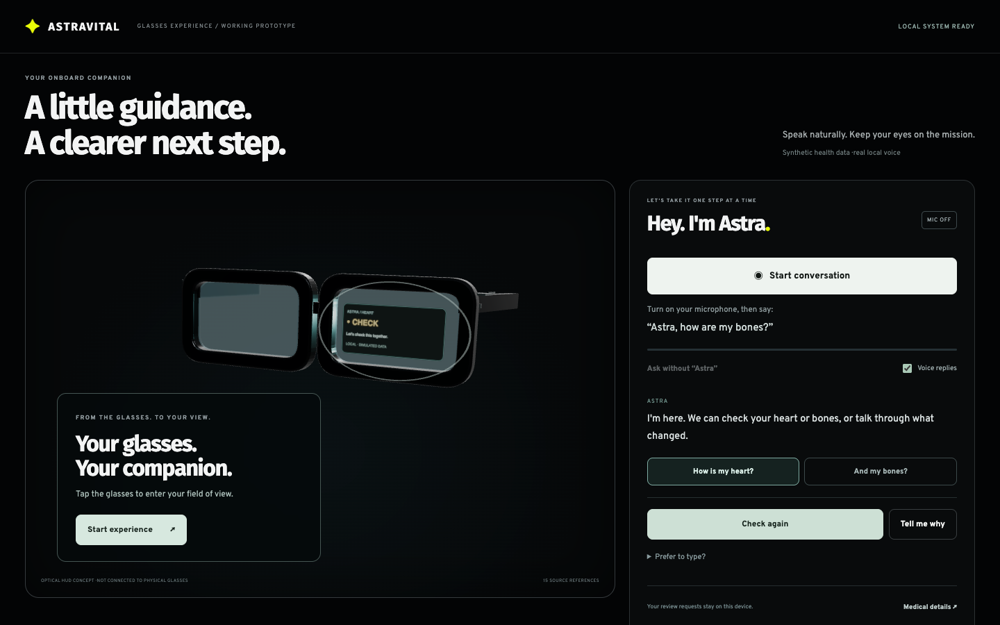
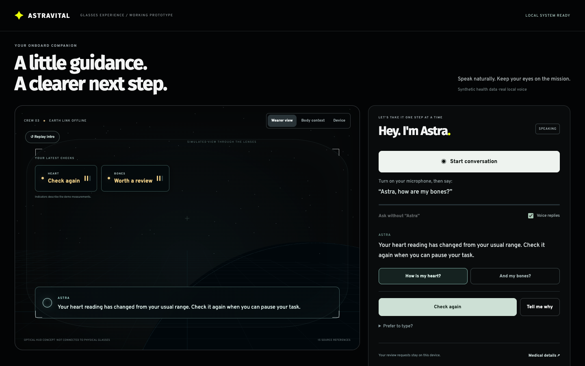
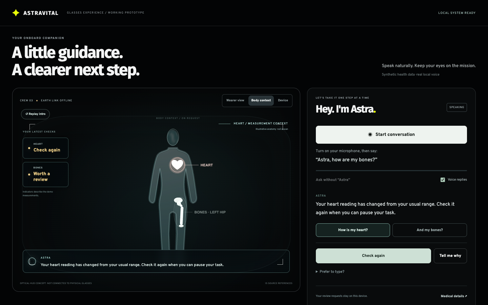
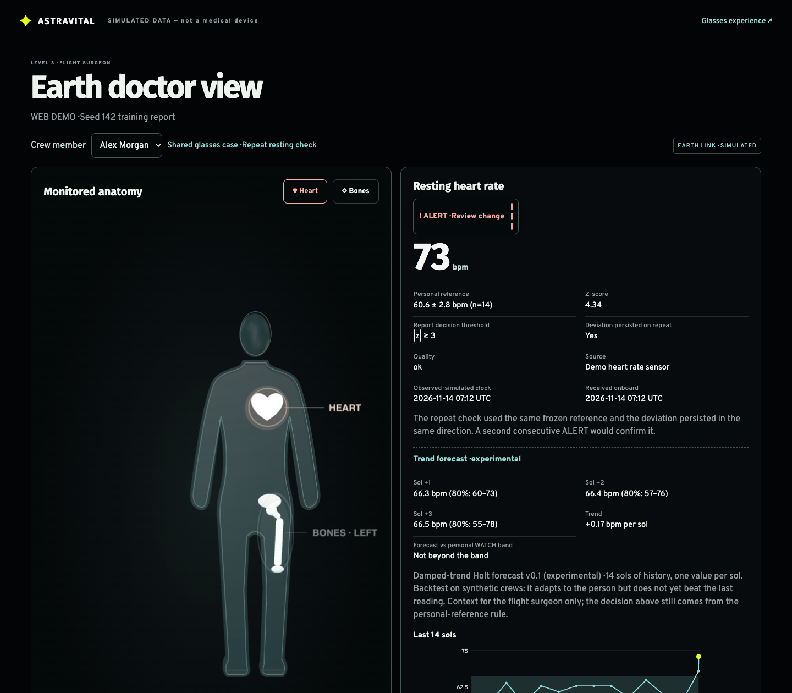

# ASTRAVITAL

**An onboard health companion that keeps working when Earth can't answer.**

ASTRAVITAL helps an astronaut on a lunar station or a Mars base understand two measured health domains — **resting heart rate** and **bone density** — by comparing each reading with *their own* baseline, explaining any change in plain language and helping them prepare an **onboard medical review**. Everything runs on local hardware: no internet or Earth link is needed at runtime.

**NASA Space Apps Challenge 2026** · Challenge: [Create Health Monitoring Software for Astronauts on Space Missions](https://www.spaceappschallenge.org/2026/challenges/health-monitoring-software/)

> **Prototype with simulated data.** Measurements are synthetic and labeled as such. ASTRAVITAL does not diagnose, prescribe or contact anyone; it is not a validated medical device and is not connected to physical glasses or sensors.

---

## For judges: the two-minute overview

### The problem

- The challenge asks for software that helps astronauts **assess their own health and act**, because on long missions they carry much of the responsibility for spotting changes themselves. It names **bone density loss** and **cardiovascular events** among the health problems linked to NASA's five spaceflight hazards. [Challenge](https://www.spaceappschallenge.org/2026/challenges/health-monitoring-software/) · [NASA HRP hazards](https://www.nasa.gov/hrp/hazards/)
- Far from Earth, help is slow or absent: a one-way signal to Mars takes up to about 22 minutes, and solar conjunction can interrupt communication for weeks. [NASA](https://www.nasa.gov/wp-content/uploads/2024/01/mars-communications-disruption-and-delay.pdf)
- NASA is working toward **Earth-Independent Medical Operations (EIMO)** because current missions rely on contact with Mission Control. [NASA EIMO ConOps](https://ntrs.nasa.gov/citations/20250000009)

### What we built

| Layer | What the astronaut gets |
| --- | --- |
| **Glasses view** | A heads-up display concept: tap the glasses and the camera moves through the lens into the wearer's view, with two calm status chips — **Heart** and **Bones** |
| **Astra, the companion** | Ask by voice or text: *"Astra, how is my heart?"* Astra answers in short, plain sentences, can explain *why*, and suggests the next step (check again, or prepare a review) |
| **Personal baseline** | Each reading is compared with the same person's previous valid readings in the same context, not with a population average |
| **Data you can trust** | Missing, invalid or incompatible data are shown as such and never replaced by an invented value |
| **Human review without Earth** | Saving a review request needs a separate, explicit confirmation; it stays on the local system and is never presented as delivered to Earth |

### What is real and what is simulated

| Working now | Simulated | Future work |
| --- | --- | --- |
| Local server, database, decision rules, Astra's dialogue, glasses interface, offline browser cache, local speech recognition, onboard CMO console, Earth doctor view, an experimental trend forecast for the doctor | Heart-rate and bone measurements (seed 142), the wearable device, the crew phone client, the Earth link (3–22 minute one-way delay model) | Real sensors (for example, a CSA Bio-Monitor adapter), real delivery to flight surgeons over delay-tolerant networking, more health domains, clinical validation |

## Screenshots (simulated data)

| Glasses intro | Wearer view and Astra | Body context |
| --- | --- | --- |
|  |  |  |



**No install? Open the live web demo: https://granitespinoza.github.io/astravital/** When no local server is running, the same pages run in the browser: the identical dialogue rules over seed-142 states exported from the database (parity test: `tests/web-demo.test.js`). **Reset demo** (in the web demo notice) returns it to its first state. Voice, the SQLite database and the crew → CMO → Earth rehearsal run only in the full local app.

---

## Earth doctor view

Open **Earth doctor view** from the glasses page to inspect a simulated flight-surgeon report. The body view links to resting heart rate and left-hip bone density. The heart panel shows the personal reference, a 14-sol history, the decision threshold and whether the deviation persisted on the repeat check. The inbox puts **confirmed ALERTs** (two consecutive ALERT readings in the same direction) first, and the evidence panel exposes Bronze, Silver and Gold records.

**Trend forecast · experimental (doctor only).** The heart panel also shows a damped-trend Holt forecast of resting heart rate for the next three sols, with 80% intervals, from one value per sol. It never changes the decision, never reaches Astra or the crew, and is labeled experimental: in a time-ordered backtest on 200 synthetic crews × 180 sols it adapts to each person (error 1.49 bpm versus 3.05 bpm for a fixed reference) but does **not** yet beat simply repeating the last reading (1.46 bpm), and the current rule flags a gradual drift earlier. So our claim stays **early warning**, not prediction. [Results](docs/RESULTADOS.md#experimental-trend-forecast--2026-11-15)

- **Web demo** opens Alex Morgan's received training report. Start with the glasses, then select **Earth doctor view** to inspect the same resting check from Ground. After **Check again**, the link opens the repeat check with the same personal reference and evidence. Select **Heart** or **Bones** to zoom into the corresponding zone, then choose **Full body** to return to the overview. Alex has synthetic DXA scans. The other crew members have no scans. Ground actions stay in this browser.
- **Local rehearsal** starts with `node scripts/start-mission.mjs` at `http://127.0.0.1:8766/mission.html`. Pair a crew client, send readings and queue a report. **Simulate Earth receipt** advances the exercise immediately. Actions stay in SQLite. See the [walkthrough](docs/MISSION-LAN.md).
- With `npm run demo` (no mission profile), **Earth doctor view** shows the same seed-142 training report as the web demo; live crew readings need the mission rehearsal above.

**From space to Earth · future vision.** A similar workflow could help clinicians review delayed observations from people in remote terrestrial settings. This prototype exercises the workflow with synthetic observations and local actions.

## Try the demo (about 1 minute)

1. Open the [live web demo](https://granitespinoza.github.io/astravital/), or `http://127.0.0.1:4173/` after [starting it locally](#run-it-locally). Tap the glasses or **Start experience**: the camera moves through the lens into the wearer's view.
2. The visor shows **Heart: Check again** and **Bones: Worth a review**.
3. Press **Talk to Astra** and say *“OK Astra, how is my heart?”* (Astra only acts after hearing its name; in the web demo this uses your browser's speech recognition), or type it. Astra explains that the reading differs from the usual resting pattern.
4. Choose **Check again**. The repeat keeps the original reference, so a real change cannot be "normalized away"; the heart chip becomes **Review change**.
5. Choose **Prepare review**, then **Confirm save**. The request is saved locally; Astra states that nothing was sent to Earth.
6. Choose **Tell me why** or **Medical details** to see the numbers behind the summary: value, personal reference, z-score, data quality and source records.
7. Choose **Message your medical team** and send Astra's draft.
8. Select **Earth doctor view ↗**: the flight surgeon's dashboard opens on the same repeated check, with a patient card, the inbox, evidence and the experimental trend forecast. Press **Reply to astronaut**, then return to the glasses: the reply arrives in the lens as a notification and Astra reads it aloud.

The page also has a **How to try it (30 s)** guide, and a **Full motion** switch in the header, on by default: the 3D glasses move on their own and tilt toward your cursor, the glass in the wearer view drifts with a glint, and the entry into the lens lasts 3.8 s. Switch it off to simplify the animations; your choice is remembered.

---

## How it works

```mermaid
flowchart LR
  subgraph station["Lunar or Mars station · works offline"]
    direction TB
    sensors["Synthetic sensors<br/>resting heart rate · DXA bone"] --> bronze["BRONZE<br/>raw records + provenance"]
    bronze --> valid{"Validation"}
    valid -->|invalid| quarantine["QUARANTINE<br/>with reasons"]
    valid -->|valid| silver["SILVER<br/>normalized records"]
    silver --> gold["GOLD<br/>personal baseline · z-score · bone LSC · evidence IDs"]
    gold --> astra["Astra · rule-based dialogue<br/>glasses view · local voice"]
    gold --> cmo["CMO console"]
    gold --> forecast["Trend forecast<br/>experimental · read-only"]
    astra --> crew(["Astronaut"])
    astra -->|"confirmed review request"| cmo
    cmo --> report["Frozen report"]
  end
  subgraph earth["Earth · simulated"]
    direction TB
    ground["Earth doctor view<br/>heart · bones · inbox · evidence"] --> surgeon(["Flight surgeon"])
    surgeon --> actions["Acknowledge · note · teleconsult request<br/>saved locally"]
  end
  report -->|"simulated 3–22 min delay"| ground
  forecast -.->|"doctor only"| ground
  style station fill:#0b2627,stroke:#90dcd9,color:#eef3ef
  style earth fill:#282215,stroke:#e8c983,color:#eef3ef
  style forecast stroke:#eafe07,stroke-dasharray:4 3
```



Every decision comes from versioned rules over Gold data. The dashed forecast is context for the flight surgeon only; it never changes a decision and never reaches the crew.

- **Local-first:** a Node.js server with SQLite (`node:sqlite`) serves the interface and the API on `127.0.0.1`. After installation the profile runs without internet while the local server is reachable.
- **Heart:** a versioned personal-baseline rule compares the latest valid resting reading with prior readings (WATCH at |z| ≥ 2, ALERT at |z| ≥ 3; simulation settings).
- **Bones:** two dated measurements are compared only when region, side, method, units and calibration match, and a change is judged against the measurement's least significant change. [Bone method and sources](docs/SALUD-OSEA.md)
- **Voice:** speech recognition runs locally with whisper.cpp. Astra's replies are spoken by a local neural voice (Kokoro-82M, Apache-2.0), generated on the device in an isolated process with network access blocked, about 3 seconds per sentence on a laptop CPU. If that voice is not installed (`node scripts/setup-tts.mjs`), voices that the browser reports as local are used.

Deep dive: [architecture](docs/ARQUITECTURA.md) · [requirements](docs/REQUISITOS-MVP.md) · [results](docs/RESULTADOS.md)

---

## Why this design should work: the evidence behind each choice

| Design choice | Why | Source |
| --- | --- | --- |
| Work without Earth | Communication delays and blackouts make real-time ground support impossible for much of a Mars mission | [NASA: Mars communications disruption and delay](https://www.nasa.gov/wp-content/uploads/2024/01/mars-communications-disruption-and-delay.pdf) · [NASA EIMO](https://ntrs.nasa.gov/citations/20250000009) |
| Heart and bone first | The challenge names cardiovascular events and bone density loss; NASA studies bone and mineral changes in crew | [Challenge](https://www.spaceappschallenge.org/2026/challenges/health-monitoring-software/) · [NASA bone and mineral evaluation](https://www.nasa.gov/directorates/esdmd/hhp/bone-and-mineral-evaluation-and-analysis/) |
| Compare with the person's own baseline | Wearable studies detected illness early by flagging resting heart rate above each person's baseline | [Mishra et al., 2020, *Nature Biomedical Engineering*](https://www.nature.com/articles/s41551-020-00640-6) |
| Show missing, stale and unusable data | NASA crew-interface requirement V2 10020: indicate when data are stale, missing, unavailable or unknown | [NASA-STD-3001 Vol. 2, §10](https://www.nasa.gov/reference/10-0-crew-interfaces-vol-2/) |
| The astronaut decides; Astra explains | Requirements V2 10169 (the operator decides when to use a decision aid) and V2 10170 (decision aids explain rationale and consequences) | [NASA-STD-3001 Vol. 2, §10](https://www.nasa.gov/reference/10-0-crew-interfaces-vol-2/) |
| Layered, plug-in data architecture | NASA's Medical Data Architecture project found in-flight medical data minimally integrated with onboard devices and used a modular, layered approach | [NASA MDA](https://ntrs.nasa.gov/citations/20170000744) · [MDA test bed](https://ntrs.nasa.gov/citations/20200000568) |
| A wearable as the future data source | The CSA Bio-Monitor (smart shirt, headband and app) has recorded crew vital signs on the ISS since 2019 | [CSA Bio-Monitor](https://www.asc-csa.gc.ca/eng/sciences/astroskin.asp) |
| Risk grows with distance | NASA's Integrated Medical Model shows medical risk strongly correlated with distance from Earth and mission duration | [Antonsen et al., 2022, *npj Microgravity*](https://doi.org/10.1038/s41526-022-00193-9) |
| A heads-up display | NASA's SUITS challenge explores augmented-reality displays that reduce astronauts' cognitive load | [NASA SUITS](https://www.nasa.gov/learning-resources/spacesuit-user-interface-technologies-for-students/) |

**Related work we build on, not claim:** the CSA Space Health study investigates autonomous cardiovascular health monitoring and an astronaut digital twin with Bio-Monitor data. ASTRAVITAL focuses on the crew-facing layer: seeing, understanding and requesting human review without Earth. [CSA](https://asc-csa.gc.ca/eng/iss/news.asp)

---

## How we keep Astra from making things up

An assistant that gives an astronaut a wrong health answer is worse than no assistant. Astra is designed so that it **cannot invent a health fact**:

1. **No generative model writes health answers.** Astra is a bounded, rule-based dialogue policy ([`server/assistant.mjs`](server/assistant.mjs)) with a closed set of intents: status, explain, compare, check again, request review, confirm, cancel and mute, in English and Spanish.
2. **Every answer comes from the local record.** Sentences are fixed templates filled only with values computed from validated (Gold) data, and every response carries the evidence IDs of the records it used.
3. **No data means no answer.** Missing, invalid or incompatible measurements produce *"I can't assess…"*, never a plausible-looking value.
4. **Out-of-scope questions are declined.** Asked for a diagnosis, a disease, treatment or medication, Astra says the measurements cannot support it and that the onboard medical officer decides on care. Asked whether it is a heart attack, or told about chest pain, it asks the astronaut to tell the onboard medical officer now. Told *"I feel dizzy"*, it asks the astronaut to tell the onboard medical officer. Asked to contact Earth, it says Earth is unavailable and that it has not contacted anyone. Anything unrecognized gets a clarifying question, not a guess.
5. **Actions need a separate confirmation.** A review request opens a pending confirmation tied to the exact context; it expires after 5 minutes and is saved only once (idempotent request ID).
6. **A repeat cannot hide a change.** The check keeps the original reference instead of absorbing the deviation.
7. **Voice is input, not evidence.** Speech is transcribed locally and shown back as *"You said: …"*; it never becomes a measurement, and write actions still need confirmation.
8. **The forecast is a formula, not a model that writes text.** The experimental trend forecast is deterministic exponential smoothing shown only to the flight surgeon, with its interval and its backtest result; it never changes a decision and Astra never mentions it.

These behaviors are covered by automated tests, for example *"request, ambiguous confirmation and cancellation never persist a review"* and *"mute and out-of-scope medical questions retain evidence without inventing a diagnosis"* in [`tests/assistant.test.js`](tests/assistant.test.js). Details: [AI safety](docs/AI-SAFETY.md).

---

## Run it locally

Requirements: **Node.js 22.13 or newer**, npm and a current browser. From the repository root:

```sh
npm ci
npm run build
npm run setup:voice
npm run demo
```

- Rubric self-check: [docs/RUBRIC.md](docs/RUBRIC.md).
- Open **http://127.0.0.1:4173/** (glasses view) and **http://127.0.0.1:4173/review.html** (supporting review). **http://127.0.0.1:4173/health** reports database, seed and voice readiness.
- Installation and voice setup need internet once; afterwards the demo runs locally. `setup:voice` downloads and hash-verifies the speech model and needs a `whisper-cli` executable (`npm run setup:voice -- --install-binary` on macOS with Homebrew). Without it, the text controls keep working and the limitation is shown.
- The SQLite database defaults to `.runtime/demo.sqlite` and is seeded with **seed 142** automatically. `PORT`, `HOST`, `DB_PATH` and `SEED` can be overridden ([.env.example](.env.example)).
- **Start the demo from a clean state** (for example, before recording): stop the server, delete `.runtime/demo.sqlite` and start it again. Saved review requests from earlier runs are removed and seed 142 is applied again.

### API

For the three-level mission rehearsal, see [Mission LAN demonstration](docs/MISSION-LAN.md). It adds a phone crew simulator, a laptop CMO view and an Earth doctor dashboard to the same local database.

| Route | Purpose |
| --- | --- |
| `GET /health` | API, database, seed and voice readiness |
| `GET /api/state?domain=cardiovascular` | Derived heart state (`domain=bone` for bones) |
| `GET /api/evidence` | Evidence and data provenance |
| `GET /api/reviews` | Saved review requests |
| `POST /api/assistant` | `{ text, sessionId }` — one dialogue turn |
| `POST /api/transcribe?language=en` | WAV body — local speech recognition |
| `POST /api/speak` | `{ text }` — reads an existing Astra sentence aloud with the local voice (WAV) |
| `POST /api/reviews` | `{ domain, scenario, confirmed, requestId }` — explicit, idempotent |

### Verify

```sh
npm run verify          # build + 75 automated tests
npm run test:e2e        # web demo in headless Chrome (also run against the live site after each deploy;
                        # E2E_DATE=2027-01-26 repeats it with a shifted clock to prove the demo does not expire)
npm run test:functional # full local app: real server and SQLite, glasses → crew phone → CMO → Earth doctor
npm run test:browser    # earlier glasses simulator and review console
node scripts/forecast-eval.mjs   # time-ordered backtest of the experimental forecast
```

Latest local run (2026-11-15, macOS, Node 22.23.2): **75 tests, 73 passed, 0 failed, 2 skipped**; web demo end-to-end **84/84** (layouts at 768 px and 390 px, a readability audit with a 12 px text floor and WCAG AA contrast, the motion switch, Reset demo), also passing with the clock set to 2026-12-03, 2026-12-17, 2027-01-26 and 2027-03-31; full local app end-to-end **17/17**; earlier browser check passed. CI repeats the build, the tests and both end-to-end runs on every push. The two skipped tests are opt-in integration runs of the real local voice models; run on the same day with `RUN_TTS_INTEGRATION=1` (Kokoro synthesis with a network guard) and `RUN_VOICE_INTEGRATION=1` (speech recognition on synthetic speech), **both passed** (4/4 and 6/6). All results and limits: [docs/RESULTADOS.md](docs/RESULTADOS.md).

---

## NASA and partner resources used

- **NASA:** Human Research Program [hazards](https://www.nasa.gov/hrp/hazards/), [risks](https://www.nasa.gov/hrp/risks/) and [ongoing research](https://www.nasa.gov/hrp/ongoing-hrp-research/) (challenge resources); [NASA-STD-3001 Vol. 2 crew interfaces](https://www.nasa.gov/reference/10-0-crew-interfaces-vol-2/); [Mars communications disruption and delay](https://www.nasa.gov/wp-content/uploads/2024/01/mars-communications-disruption-and-delay.pdf); [EIMO concept of operations](https://ntrs.nasa.gov/citations/20250000009); [Medical Data Architecture](https://ntrs.nasa.gov/citations/20170000744); [bone and mineral evaluation](https://www.nasa.gov/directorates/esdmd/hhp/bone-and-mineral-evaluation-and-analysis/); [Mars24 sol length](https://www.giss.nasa.gov/tools/mars24/help/notes.html).
- **Canadian Space Agency:** [Bio-Monitor](https://www.asc-csa.gc.ca/eng/sciences/astroskin.asp), [Space Health study](https://asc-csa.gc.ca/eng/iss/news.asp) and [Monitoring Radiation for Astronaut Health](https://www.asc-csa.gc.ca/eng/news/articles/2026/2026-02-26-monitoring-radiation-astronaut-health.asp) (challenge resource).
- The synthetic measurements are **not** NASA physiological data. Full source register: [docs/AUDITORIA-REFERENCIAS.md](docs/AUDITORIA-REFERENCIAS.md).

---

## Use of AI (SI disclosure)

The team defined the ASTRAVITAL concept and its scope. **OpenAI Codex** and **Anthropic Claude** assisted with code, tests, synthetic scenarios, research, source verification and documentation. No AI generates health answers at runtime (see above). Speech recognition (whisper.cpp) and the optional neural voice (Kokoro) are pretrained local models; packaged interface audio cues were synthesized locally. Five illustrations (three anatomy views in the app, two concept images) were generated with ChatGPT (OpenAI image generation) and carry a visible "AI-generated image" watermark; they are illustrative only and do not represent astronaut measurements, diagnoses or mission telemetry, and all values, status colours and alerts are rendered by the application. No AI-generated video is used. Full record: [docs/SI-USAGE.md](docs/SI-USAGE.md).

## Credits and license

Third-party components: three.js (MIT), esbuild (MIT), whisper.cpp (MIT), kokoro-js and Transformers.js (Apache-2.0), Fira Sans and Overpass fonts (SIL OFL, see [licenses](licenses/)). The repository has no project license selected yet. ASTRAVITAL uses its own name and claims no NASA or CSA endorsement.
