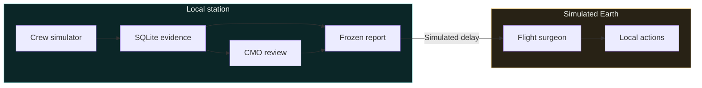
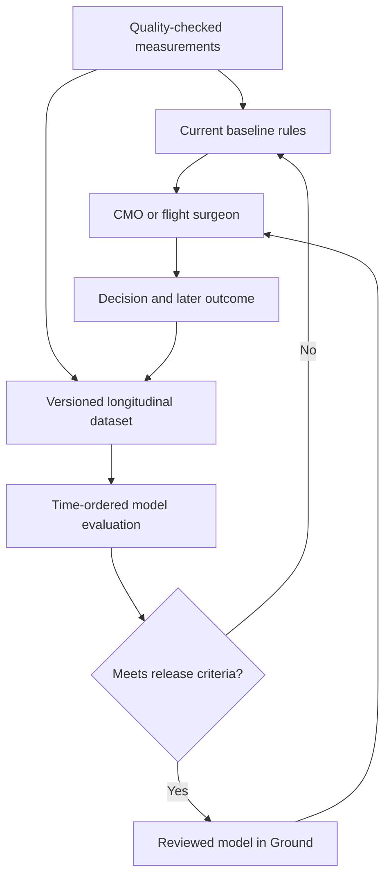

# Architecture derived from the local workflow

AI assistance: OpenAI Codex. Updated 2026-11-15 for the authorized executable increment. Integrated verification is tracked in [RESULTADOS.md](RESULTADOS.md); the Azure profile remains a proposal/scaffold.

## Step 0: problem and boundary

Help a crew member interpret a personal cardiovascular change or compatible longitudinal bone measurement and deliberately save a review request without waiting for Earth. The demonstration uses virtual measurements, a local computer and a browser glasses UI. Real microphone input asks questions; it does not measure physiology.

The selected [Space Apps challenge](https://www.spaceappschallenge.org/2026/challenges/health-monitoring-software/) calls for gathering health indicators for self-assessment and action. NASA HRP's [five hazards](https://www.nasa.gov/hrp/hazards/) are radiation, isolation/confinement, distance, gravity fields and hostile/closed environments; they are not five missions or an obligation to implement five health modules. This increment supports only cardiovascular and bone domains.

## Iteration 1 — system boundary

```text
Virtual sources -> local ASTRAVITAL -> explained state/evidence
Microphone -> local ASR -> structured assistant -> same explained state
Explicit confirmation -> persisted review request -> saved acknowledgement
Earth / cloud: optional future destination, outside the local critical path
```

## Iteration 2 — responsibilities and ownership

| Capability | Owner | Data / rule |
| --- | --- | --- |
| Seed and virtual observation ingest | Data layer | Stable IDs, seed/schema/generator versions, synthetic flag and input hash |
| Bronze retention | Ingest | Original observations preserved; no edits by assistant or evaluator |
| Quality/quarantine and Silver | Data pipeline | Types, units, provenance, context, duplicate/conflict detection |
| Gold state | Domain evaluators | Cardiac baseline/quality and compatible bone comparisons with evidence IDs |
| Turn interpretation | Assistant | Session domain, unresolved question, permitted actions; no free SQL |
| Voice recognition | Voice adapter | WAV plus configured local binary/model, capability/error reporting |
| Review action | API/data transaction | Confirmed requestId; idempotent write; success only after save |
| UI and cache | Browser | View state and local assets; no second master measurement database |
```

## Iteration 3 — local profile

```text
[Virtual sensor / seed142] -> (Bronze: originals)
                                  |
                           [quality validation] -> (Quarantine + reasons)
                                  |
                           (Silver: normalized)
                                  |
                      [Cardiovascular / Bone evaluator]
                                  |
                        (Gold: state + evidence)
                                  |
[Microphone] -> [local ASR] -> [Assistant + session] <-> [Local Node API]
                                  |                         |
                        [Glasses UI / review]       (Review transaction)
                                  |                         |
                         (Asset cache only)        saved acknowledgement
```

SQLite on local disk owns the logical layers and review events. These medallion responsibilities do not imply Spark, Delta Lake or Databricks. No connection skips quality checks or rewrites original evidence. An unavailable reading is a valid outcome; filling a gap with an invented number is not.

## API and data contracts

The optional [mission LAN profile](MISSION-LAN.md) adds a scoped synthetic crew client, an onboard CMO console and a simulated Ground inbox. It uses this same SQLite file and the main cardiovascular rule. The phone queue retains only unconfirmed packets. The latest received report carries the frozen heart decision, the matching bone state from the domain API contract and links to source records. Actions stay in SQLite in the local profile and in browser storage in the web demo.



The report is visible after the modeled 3–22 minute delay or when the operator advances the simulation. The judge-facing web demo reads the same report format generated by the seed-142 mission engine.

| Contract | Meaning |
| --- | --- |
| `GET /health` | API/database/seed and voice capability status; availability is not implied by a green UI alone |
| `GET /api/state?domain=cardiovascular\|bone&scenario=deviation` | Derived domain state, measured/simulated time, quality and cited evidence |
| `GET /api/evidence` | Inspectable evidence/provenance |
| `POST /api/assistant` `{text,sessionId}` | Final text turn, session context, supported intent and grounded response |
| `POST /api/transcribe?language=es\|en` | WAV body; recognizer/model status and transcription/error |
| `POST /api/reviews` `{domain,scenario,confirmed,requestId}` | Explicit, state-checked, idempotent local save |
| `GET /api/reviews` | Saved review records |
| `GET /api/mission/ground` | Local mission staff report status, received crew snapshots and priority inbox |
| `POST /api/mission/ground-action` | Confirmed acknowledgment, note or simulated teleconsult request with an idempotent request ID |

Seed is automatic on initial database creation; `npm run seed` is the reproducibility CLI. No public seed/reset HTTP endpoint is exposed. Authentication, tenancy and retention for real patient data are outside this synthetic local prototype.

Observation responsibilities: identity, domain/indicator, value/unit, observed time, context or anatomical region/side, source, quality, simulated flag and schema/seed provenance. Bone comparison additionally requires compatible method/calibration and precision/LSC before claiming significance. The response must identify missing or incompatible evidence rather than infer a disease.

## Critical path and errors

**Value path:** virtual observation -> Bronze -> quality -> Silver -> evaluation -> Gold -> question/explanation -> deliberate confirmed review save. The ASR adapter is an input alternative to visible controls, not a source of physiological truth.

- No microphone permission / model / executable: report unavailable capability; keep controls. Never send audio to a cloud provider as a hidden fallback.
- Silence, partial/ambiguous transcript or unsupported intent: no mutation; clarify or return to available actions. Listening ends visibly; output must not trigger its own input.
- Missing/stale/suspect/disconnected data: show quality outcome before any deviation. Context-incompatible history cannot become a resting baseline.
- Bone method/region/units/precision mismatch: explain non-comparability or unknown significance; do not label osteoporosis/fracture.
- Cancel: no save. Failed transaction: no success. Retry: same requestId, one persisted request.
- WAN unavailable: local API/database/recognizer remain the required path after setup. Local server stopped: cached UI may render, but it must not claim current backend state or save success.
- SQLite file lost: explicit recovery is required. Local persistence is not a clinical durability guarantee or automatic off-device backup.

Browser speech output selects only OS/browser voices flagged `localService: true`; absent local output means text fallback, not a remote service. No Piper component is required. Voice recognition remains the local whisper.cpp adapter.

## Longitudinal learning and decision support

[Hypothesis] ASTRAVITAL could adapt to an astronaut's longitudinal record and estimate a future measurement. The executed prototype compares an observed resting heart-rate reading with a personal reference. It freezes that reference through repeat checks. Its bone workflow compares compatible scans against an assumed least significant change. The proposed branch below is an evaluation and release path. It has no runtime component in this increment.



| Stage | Proposed acceptance criteria |
| --- | --- |
| Acquire usable history | Link each observation to the crew member, acquisition time, rest context, device or calibration, missingness and quality. Version the authorized dataset and record data coverage, independent crew and mission counts, and outcomes available for evaluation. |
| Test personalization | Start with estimating the next usable daily resting heart rate, in bpm. Compare each candidate with the last usable reading and the current personal reference on later held-out observations. Use earlier data for fitting, then validate on later periods. Also hold out crew or missions when making a claim across crew. |
| Determine the observation window | A pilot can compare 1, 3 and 6 months of history as study scenarios. Select any duration only after comparing error and uncertainty against data coverage and the study's intended use. Correlated daily readings, missing measurements and limited crew size affect how much evidence each window contributes. Sample adequacy depends on the outcome, effective sample and expected performance. [Riley et al.](https://www.bmj.com/content/368/bmj.m441.full) |
| Validate usefulness | Predefine acceptable error and uncertainty. Measure mean absolute error in bpm, interval coverage and missed or false flags against the comparison rules. Put candidates through prospective observation with their outputs hidden from care decisions before evaluating clinical workflow usefulness. A reduction in heart-rate forecast error establishes a measurement result. Any claim about better decisions needs a separate clinical endpoint and evaluation. [TRIPOD+AI](https://www.bmj.com/content/385/bmj-2023-078378) |
| Release with human control | Release only an explicitly approved version. Show source measurements, horizon, uncertainty and reason for each suggestion. Leave the CMO or flight surgeon in charge of accepting, dismissing or escalating it. The software records human decisions and verified outcomes independently, with no automatic treatment or changes to active thresholds. Monitor performance across contexts, hold a candidate back when evidence is insufficient and keep the rule-based path available. [IMDRF GMLP](https://www.imdrf.org/sites/default/files/2025-02/IMDRF_AIML%20WG_GMLP_N88%20Final.pdf) |

Bone remains a measurement-comparison workflow while compatible serial scans, known precision and sufficient longitudinal evidence are being established. The onboard decision path remains available through communications disruptions, consistent with NASA's exploration of support for the CMO. [NASA EIMO ConOps](https://ntrs.nasa.gov/citations/20250000009)

Use verified subsequent observations as model outcomes. Keep the clinician's action and any rationale as audit context for evaluating the workflow.

## Optional Azure profile - not implemented by the scaffold

```text
Online evaluation browser -> Container Apps API -> PostgreSQL (durable state)
                                      |
                              versioned exports -> ADLS Gen2
Online voice -> Azure Speech -> same typed assistant contract
Service access -> managed identity / Key Vault
Operational metadata -> Monitor / Application Insights
```

PostgreSQL is the proposed transaction owner in this profile; ADLS is an archive, not a mounted SQLite database. A receiver acknowledgement would mean a transaction was accepted by that receiver, not read/approved care. No live sync/ACK or archive adapter is claimed until implemented and tested.

The [Bicep scaffold](../infra/azure/README.md) is disabled by default. It models a managed environment, identity, private blob containers, Key Vault and monitoring, with an explicit opt-in ephemeral API preview. It does **not** provision PostgreSQL/Speech or wire persistence. Container Apps local storage is [ephemeral](https://learn.microsoft.com/en-us/azure/container-apps/storage-mounts); therefore the preview is not the durable Azure profile. No resources were deployed.

Azure Speech requires a separately configured online service; no disconnected Speech entitlement is assumed. [Speech overview](https://learn.microsoft.com/en-us/azure/ai-services/speech-service/overview). Managed identity and resource-scoped RBAC replace embedded cloud credentials where supported. [Container Apps identity](https://learn.microsoft.com/en-us/azure/container-apps/managed-identity).

## Reliability, scale and measurable gates

The current dataset is a bounded synthetic demonstration. Production rate, concurrency, availability, storage retention and device battery targets are unmeasured. Do not turn the exploratory 4-person/1-Hz workload estimate into an achieved load result; bone observations are periodic, not 1-Hz telemetry.

| Risk | Current response / acceptance | Remaining limitation |
| --- | --- | --- |
| Bad input / conflicting IDs | Quality/quarantine plus provenance; deterministic tests | Real sensor validity not established |
| Database/write loss | Transaction, request ID, restart/read-back tests | Off-device backup/failover not implemented |
| ASR unavailable or incorrect | Capabilities, visible error, buttons and confirmation | Real microphone accuracy/latency needs an actual run |
| WAN outage | Local artifacts and localhost-only critical path | Setup/download still needs access; cloud profile is online |
| Cloud replica replacement | Persistent PostgreSQL adapter required before durable release | Scaffold has no such adapter or database |

Fitness gates: **0** failed domain/data tests; repeat seed adds **0** duplicate observations; repeated requestId adds **0** duplicate requests; a failed save yields **0** success acknowledgements; local-profile API/voice makes **0** external network requests after setup. These are proposed acceptance assertions until an actual command/result is recorded. Measure transcript accuracy, latency and memory on the selected laptop before assigning numeric performance targets.

References for implementation claims: [requirements](REQUISITOS-MVP.md), [results](RESULTADOS.md), [synthetic data](../data/README.md), [NASA interface inputs](https://www.nasa.gov/reference/10-0-crew-interfaces-vol-2/), [EIMO](https://ntrs.nasa.gov/citations/20250000009).
